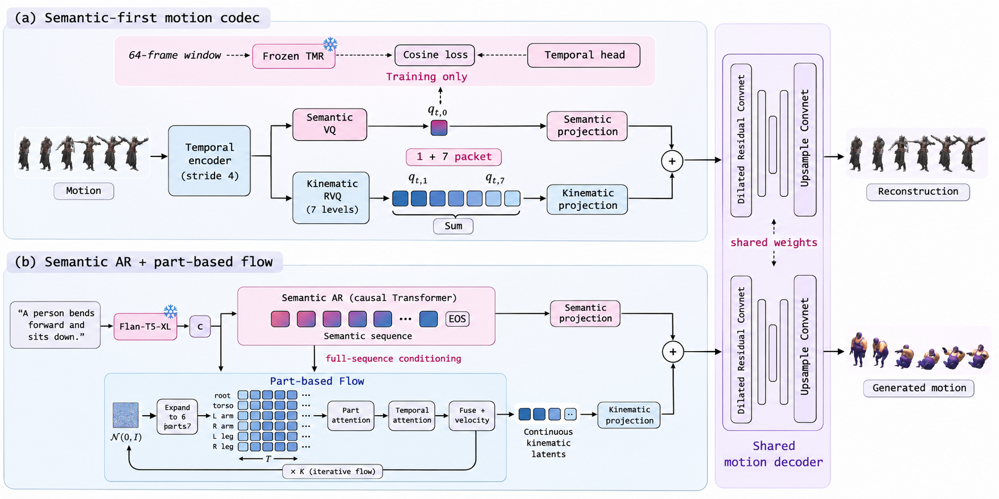

# SeMoCo

[Models][models] | [Training](docs/TRAINING.md) | [Inference](docs/INFERENCE.md)



SeMoCo combines semantic motion tokens with body-structured flow matching for text-to-motion generation.

## Installation

Requires Python 3.11+ and PyTorch with CUDA.

```bash
git clone https://github.com/OMEGA-i/SeMoCo.git
cd SeMoCo
pip install -e '.[text]'
```

## Pretrained Models

Download the [pretrained models][models] and extract them into `checkpoints/`.
See [Model Files](docs/CHECKPOINTS.md) for the directory structure.

## Inference

```bash
semoco-generate --config configs/humanml3d_inference.yaml \
  --inputs data/prompts.npz --output runs/motion.npz
```

Use `configs/omega_inference.yaml` for Ω-MotionVerse.
See [Generation](docs/INFERENCE.md) and [Tokenization](docs/TOKENIZER.md) for details.

## Training

Follow [Data Preparation](docs/DATA.md), then train the tokenizer and generator:

```bash
# Tokenizer
semoco-train-tokenizer --config configs/humanml3d_tokenizer.yaml \
  --windows data/train_windows.npy --teacher data/train_tmr.npy \
  --feature-stats data/feature_stats.npz --output runs/tokenizer

# Generator
semoco-train-ar --config configs/humanml3d_ar.yaml \
  --store data/store --output runs/ar
semoco-train-flow --recipe hml-base --store data/store --targets data/store \
  --output runs/flow
```

See [Training](docs/TRAINING.md) for continuation training and Ω-MotionVerse.

## Evaluation

```bash
semoco-score --dataset humanml3d --embeddings runs/test/seed*.npz
```

See [Evaluation](docs/EVALUATION.md) for the evaluators and test protocol.

## Acknowledgements

We thank [TMR](https://github.com/Mathux/TMR),
[TMR-SOMA-RP](https://huggingface.co/nvidia/TMR-SOMA-RP-v1),
[HumanML3D](https://github.com/EricGuo5513/HumanML3D), and
[SOMA-X](https://github.com/huster-wgm/SOMA-X) for their open-source resources.

## License

[Apache-2.0](LICENSE).

[models]: https://huggingface.co/poisonousID/SeMoCo
